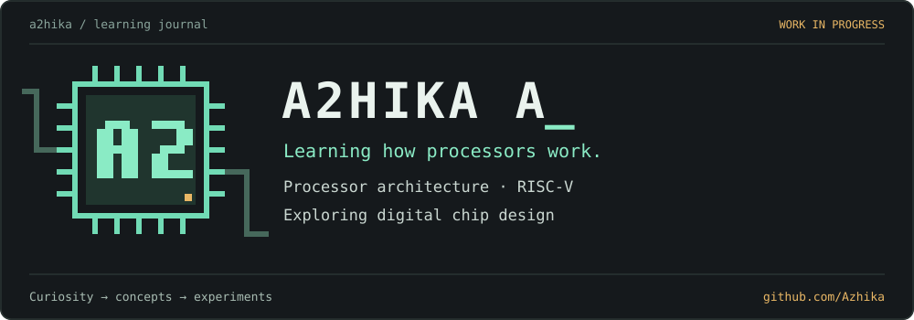
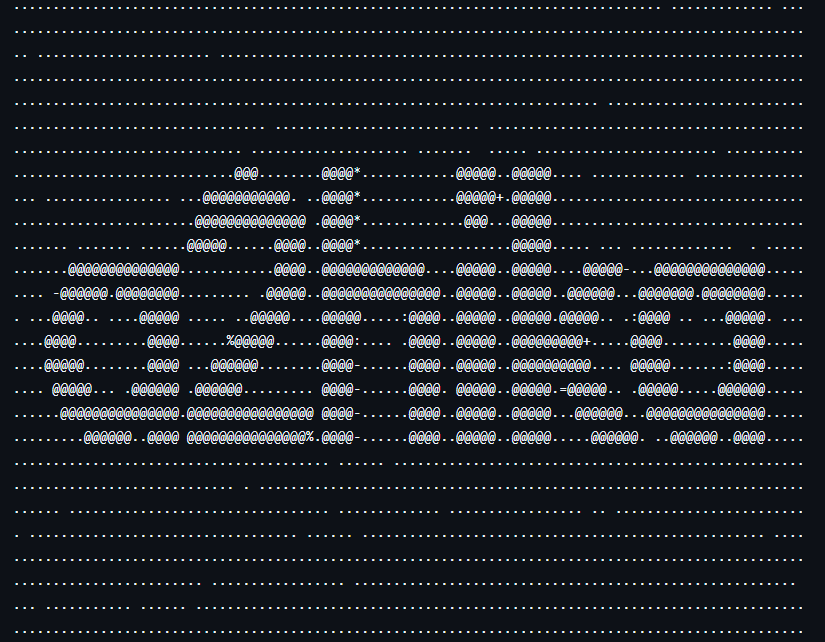

<!-- ░░ HEADER ░░ -->
<p align="center">
  
</p>

<p align="center">
  <a href="https://github.com/Azhika">
    
  </a>
</p>

<p align="center">
  
  <a href="https://github.com/Azhika?tab=followers"></a>
  <a href="https://github.com/Azhika?tab=repositories"></a>
</p>

---

## ⚡ About me

```verilog
module azhika (
  input  wire curiosity,
  input  wire coffee,
  output reg  silicon
);
  // focus   : processor architecture, RISC-V, digital chip design
  // building: CPUs in Verilog · IoT dashboards · ESP32 telemetry
  // learning: pipelining, memory systems, CMOS & VLSI flow
  always @(posedge curiosity) silicon <= build(coffee);
endmodule
```

- 🔬 Exploring **processor architecture & RISC-V** and working toward **digital chip design**
- 🧠 Built a custom **8-bit multicycle CPU** and a **RISC-V RV32I pipelined core**
- 🌐 Also connect hardware to the web — **ESP32 → FastAPI → Next.js** dashboards
- 📚 Notes: [Digital electronics](https://github.com/Azhika/digital_electronics) · [Memory & buffers](https://github.com/Azhika/digital_electronics/tree/main/memory)

---

## 🧩 Featured hardware projects

<table>
<tr>
<td width="50%" valign="top">

### 🖥️ [8-bit Multicycle Processor](https://github.com/Azhika/8-bit-multicycle-processor)
Custom **Harvard-architecture** CPU with a **14-instruction ISA**, six-state FSM control unit, ALU, register file and separate I/D memories. Verified in Vivado.

`Verilog` `Vivado` `FSM` `CPU design`

</td>
<td width="50%" valign="top">

### 🚀 [RISC-V RV32I Pipelined Core](https://github.com/Azhika/RISCV_32I_Pipelined_Core)
A pipelined **RV32I** core built in TL-Verilog on Makerchip — fetch, decode, execute, memory and write-back with hazard handling.

`TL-Verilog` `RISC-V` `Makerchip` `Pipelining`

</td>
</tr>
<tr>
<td width="50%" valign="top">

### 💾 [Dual-Port RAM](https://github.com/Azhika/dualport_ram-)
Synthesizable dual-port memory with independent read/write ports and testbench.

`Verilog` `Memory` `Testbench`

</td>
<td width="50%" valign="top">

### 🔌 [Combinational Circuits](https://github.com/Azhika/combinational-circuits-vivado-execution-)
Muxes, decoders, adders, comparators and more — each with a testbench, simulated in Vivado.

`Verilog` `Vivado` `Simulation`

</td>
</tr>
</table>

<p align="center">
  <a href="https://github.com/Azhika/HDLBits-Verilog-solutions"></a>
  <a href="https://github.com/Azhika/NASSCOM-RISC-V-based-MYTH-program"></a>
</p>

## 🌡️ Connected systems

| Project | What it does | Stack |
| :--- | :--- | :--- |
| **[Therma](https://github.com/Azhika/therma-heat-strain-dashboard)** | Heat-strain monitoring with anomaly detection & live ESP32 telemetry | Next.js · TypeScript · FastAPI · ESP32 |
| **[NeuroTrace-X](https://github.com/Azhika/NeuroTrace-X)** | Work in progress | — |

---

## 🛠️ Toolbox

**Hardware & HDL**
<p>
  
  
  
  
  
  
</p>

**Software**
<p>
  
  
  
  
  
  
</p>

---

## 📊 GitHub stats

<p align="center">
  
  
</p>
<p align="center">
  
</p>

## 🐍 Contribution snake

<p align="center">
  <picture>
    <source media="(prefers-color-scheme: dark)" srcset="https://raw.githubusercontent.com/Azhika/Azhika/output/github-snake-dark.svg"/>
    <source media="(prefers-color-scheme: light)" srcset="https://raw.githubusercontent.com/Azhika/Azhika/output/github-snake.svg"/>
    
  </picture>
</p>

---

<p align="center">
  
</p>

<p align="center"><sub>A2HIKA A · Learning through implementation, simulation, and iteration.</sub></p>
